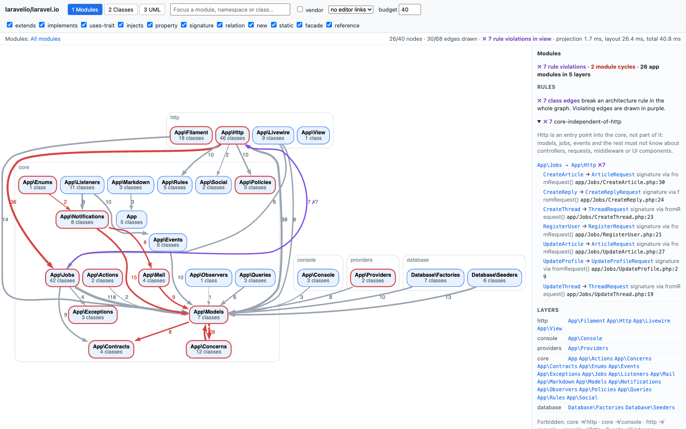
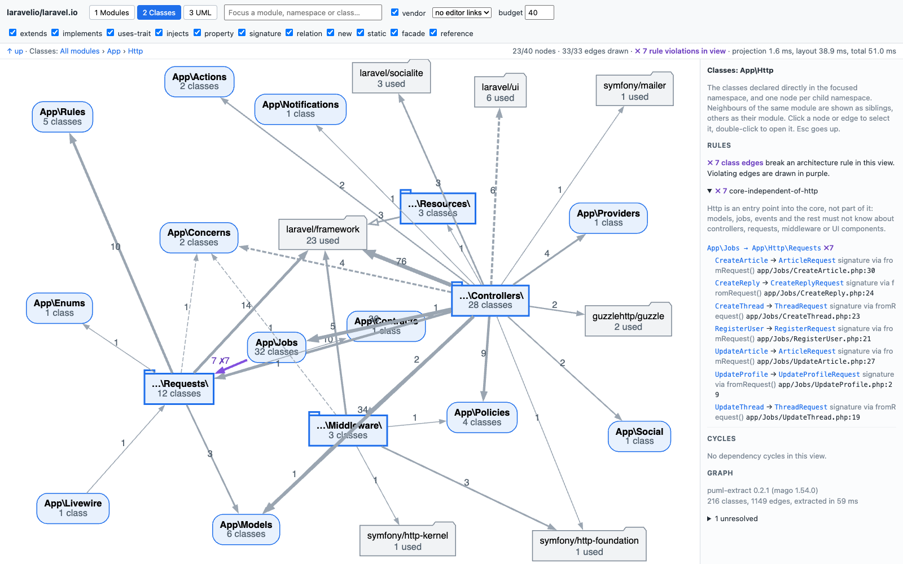
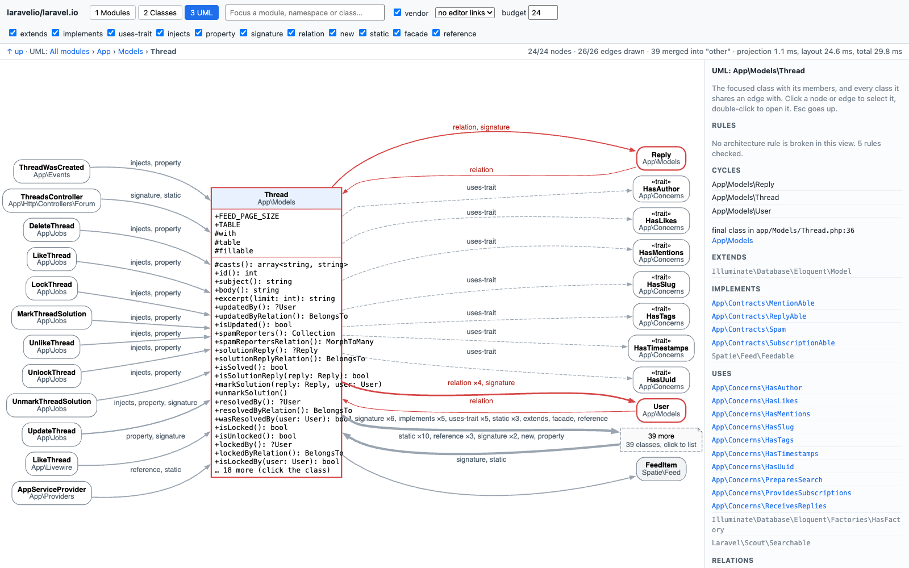
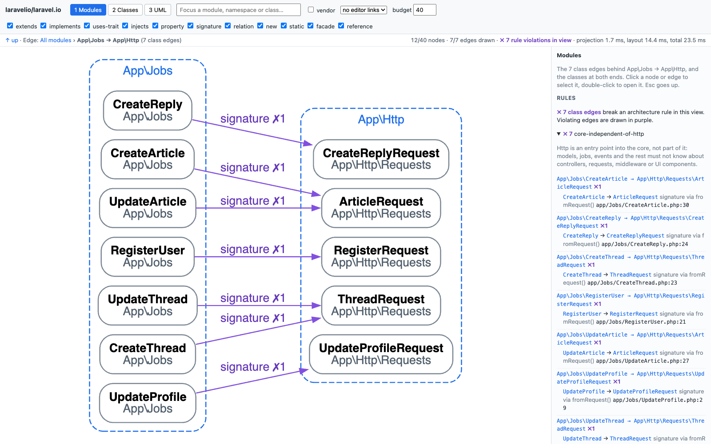

# puml

See how your Laravel or PHP application is actually put together. puml reads your code, draws its
modules, classes and dependencies in an interactive diagram you can drill into, and tells you where the
architecture breaks the conventions a Laravel application is expected to follow.



- **One command, one file.** `puml-extract` scans a project in well under a second and writes a single
  HTML file. Open it in any browser; nothing to install, no server, no PHP runtime needed.
- **Three levels of detail.** Start with the modules, double-click into a namespace, end at the UML of a
  single class.
- **Every arrow has a source.** Each dependency lists the `file:line` it comes from, and can open there
  in your editor.
- **An architecture verdict.** Rule violations, dependency cycles with the cheapest way to break them,
  and coupling metrics per module, in the viewer and in the terminal.

## Install

Download the binary for your platform from the
[latest release](https://github.com/kauffinger/puml/releases/latest):

```sh
VERSION=v0.2.1
TARGET=aarch64-apple-darwin   # x86_64-apple-darwin, x86_64-unknown-linux-musl, aarch64-unknown-linux-musl

curl -fsSL "https://github.com/kauffinger/puml/releases/download/$VERSION/puml-extract-$VERSION-$TARGET.tar.gz" | tar -xz
sudo mv "puml-extract-$VERSION-$TARGET/puml-extract" /usr/local/bin/
```

The Linux binaries are static and run on any distribution. `SHA256SUMS` in the release lets you check
the download. If you download the archive through a browser on macOS instead, remove the quarantine flag
before the first run: `xattr -d com.apple.quarantine puml-extract`.

To build from source you need Rust; the toolchain version is pinned in `extractor/rust-toolchain.toml`:

```sh
git clone https://github.com/kauffinger/puml
cd puml/extractor && cargo build --release
# the binary is extractor/target/release/puml-extract
```

## Quick start

puml resolves your classes against `vendor/`, so install the Composer dependencies first:

```sh
cd path/to/your-app
composer install
puml-extract . --html architecture.html
open architecture.html          # xdg-open on Linux
```

That is all. The HTML file contains the viewer and your project's graph, so you can send it to someone
or attach it to a pull request. Add `--dev` to include the `autoload-dev` roots, such as `tests/`, and
`--out graph.json` to keep the raw graph as well.

## A tour

The examples below are [laravel.io](https://github.com/laravelio/laravel.io), the community portal, as
puml draws it.

### Modules

The first view, shown above, has one box per module: a namespace directly under a PSR-4 root, such as
`App\Models` or `App\Http`. Each module sits in the band of its layer: `http`, `core`,
`console`, `providers` or `database`. An arrow from `App\Http` to `App\Models` means classes
in `App\Http` use classes in `App\Models`; the number on it is how many class-to-class dependencies it
stands for. Tick **vendor** to add the packages, such as `laravel/framework`, as folder-shaped boxes.

- **Red** boxes and arrows are dependency cycles: modules that, through some path, all depend on each
  other.
- **Purple** arrows break an architecture rule. Here, seven jobs in `App\Jobs` accept form requests from
  `App\Http`.

The side panel is the verdict in reading order. It lists each violation with its `file:line`, then the
layers and the directions they forbid, then each cycle with the cheapest cut. After those come the
busiest classes and the modules ranked by how much depends on them, ending with the ones nothing
depends on.

### Classes

Double-click a module to open it. Each class is a box, and each sub-namespace is one box labelled with
what is inside it, so `App\Http` stays readable even with 46 classes. Everything outside is shown only as
far as it touches the namespace you are looking at.



### UML of a class

Double-click a class to see its constants, properties and methods, with their visibility and types as
written, PHPDoc generics included. Around it are the classes it depends on and the classes that use it,
and each arrow says how: `extends`, `uses-trait`, `injects`, an Eloquent `relation` and so on. The side
panel lists its parents, interfaces, traits and Eloquent relations.



### What is behind an arrow

Double-click an arrow to open it. You see exactly the classes at both ends and the dependencies between
them. These are the seven jobs that depend on HTTP requests, which is what the purple arrow in the first
picture was about:



### Getting around

| action | effect |
|---|---|
| click a box or arrow | selects it, fades everything unrelated, and shows the details in the side panel |
| double-click a box | opens it: a module or namespace shows its classes, a class shows its UML |
| double-click an arrow | shows the class-level dependencies behind it |
| Esc, Backspace or `↑ up` | goes back up and keeps the box you came from selected |
| breadcrumb | jumps to any enclosing namespace |
| search field | jumps straight to a module, namespace or class |

The checkboxes in the toolbar hide kinds of dependencies, for example everything except `extends` and
`implements` to see only the type hierarchy. `vendor` shows the packages; the modules view leaves them
out unless it is ticked. `budget` sets how many boxes a view may have before the least important ones
are folded into one "N more" box, which you can click to list.

Text is never drawn smaller than 11 px. When a view does not fit the window, the stats line says "part
off-screen": drag to pan, scroll to zoom, or click **show all**.

Every `file:line` in the side panel can open in VS Code, Cursor or PhpStorm; choose the editor in the
toolbar. The address bar always holds the current view, so a bookmark or a shared link opens the same
picture.

## In the terminal

The same verdict is available without a browser, for CI logs, code review or a coding agent:

```sh
puml-extract report path/to/app                       # the whole verdict
puml-extract show path/to/app 'App\Models\Thread'     # one module, namespace or class
puml-extract show path/to/app 'App\Jobs' 'App\Http'   # one arrow, with every file:line behind it
```

An excerpt of `report` on laravel.io:

```
puml report: laravelio/laravel.io (216 classes, 1149 edges, puml-extract 0.2.1 (mago 1.54.0))
verdict: 7 rule violations, 2 module cycles, 9 fan-out outliers

RULES  (one line per class edge that breaks a rule)
  core-independent-of-http: 7 violations
    Http is an entry point into the core, not part of it: models, jobs, events and the rest must not know about controllers, requests, middleware or UI components.
    App\Jobs\CreateArticle -> App\Http\Requests\ArticleRequest  signature  app/Jobs/CreateArticle.php:30
    App\Jobs\CreateReply -> App\Http\Requests\CreateReplyRequest  signature  app/Jobs/CreateReply.php:24
    ...
  core-independent-of-console: ok
  ...

MODULE CYCLES
  2. 5 modules: App\Actions, App\Filament, App\Http, App\Jobs, App\Providers
     edges inside the cycle, lightest first (weight = class edges):
       App\Actions -> App\Jobs  1  new
       ...
       App\Jobs -> App\Http  7  signature x7  (7 rule violations)
       App\Http -> App\Jobs  36  new x29, static x7
     cheapest cut: App\Jobs -> App\Http (7)

MODULES
  module              classes   Ca  Ce     I     A     D  vendor  cycle    busiest class (fan-out)
  App\Http                 46    8  56  0.88  0.04  0.08      37  cycle 2  App\Http\Controllers\Forum\ThreadsController (17)
  App\Models                7  133  17  0.11  0.00  0.89      29  cycle 1  App\Models\Thread (15)
  ...

FAN-OUT OUTLIERS  (distinct app classes outside the class's own module; threshold mean + 2 sd = 6.6)
   17  App\Http\Controllers\Forum\ThreadsController  app/Http/Controllers/Forum/ThreadsController.php:33
   15  App\Models\Thread  app/Models/Thread.php:36
  ...
```

The output is sorted and stable, so two runs diff cleanly.

## What the verdict checks

### Rules

The rules describe a conventional Laravel application, following the Laravel documentation, which calls
`Http` and `Console` "an API into the core of your application". puml sorts each class by the first
namespace segment under its root:

- **HTTP**: `Http`, `Livewire`, `Filament`, `Nova`, `View`
- **Console**: `Console`
- **Providers**, **database** (`Database\…`) and **tests** (`Tests\…`)
- **Core**: everything else, such as models, jobs, actions, events and listeners

Then it checks:

| rule | in plain words |
|---|---|
| `core-independent-of-http` | models, jobs and the rest of the core do not know about controllers, requests, middleware or UI components |
| `core-independent-of-console` | the core does not know about Artisan commands |
| `http-independent-of-console`, `console-independent-of-http` | HTTP and Console are two separate entry points; one does not go through the other |
| `events-independent-of-listeners` | an event does not know who listens to it |
| `no-module-cycles` | no two modules depend on each other, directly or through others |

Providers, database classes and tests may use anything, and vendor code is never judged. A fresh
`laravel new` application passes every rule.

For each cycle, puml lists the dependencies that close it, lightest first, and the **cheapest cut**: the
smallest set of dependencies whose removal breaks the cycle. On laravel.io, moving the seven form
requests out of the jobs' signatures would fix both the rule violations and the second cycle.

### Metrics

For each module of your application:

| column | meaning |
|---|---|
| `Ca` | how many classes in other modules use this one; high means many things break when it changes |
| `Ce` | how many classes in other modules this one uses |
| `I` | instability, `Ce / (Ca + Ce)`: 0 is depended upon and stable, 1 depends on everything and is easy to change |
| `A` | abstractness: the share of interfaces and abstract classes |
| `D` | distance from the main sequence, `\|A + I - 1\|`: high means stable but concrete, or abstract but unused |
| `vendor` | how many vendor classes it uses |

A class's **fan-out** is the number of classes in other modules it uses. Classes far above the average
are listed as outliers; they are usually the controllers and models that are worth splitting first.

## What counts as a dependency

Every arrow comes from a name PHP would resolve, never from a text search:

| kind | from |
|---|---|
| `extends`, `implements`, `uses-trait` | the class declaration |
| `injects` | constructor parameter types |
| `property` | property types, native or `@var` |
| `signature` | parameter and return types, native or PHPDoc, including generics such as `Collection<int, User>` |
| `relation` | Eloquent relations such as `$this->hasMany(Post::class)` |
| `new` | `new Foo` |
| `static` | `Foo::bar()`, `Foo::CONST` |
| `facade` | a facade call, drawn to the class behind the facade |
| `reference` | `Foo::class`, `instanceof Foo`, `catch (Foo $e)` |

## Limitations

- **Install dependencies first.** Without `vendor/`, puml cannot tell that the project is a Laravel
  application, and the rules are reported as not checked.
- **The rules are for Laravel applications.** Other PHP projects still get the diagrams, cycles and
  metrics.
- **Nothing is guessed.** A dependency that is only known at runtime, such as `new $class` or a relation
  whose related class is not written as `Foo::class`, is listed under "unresolved" with its `file:line`
  instead of being drawn.
- **Editor links point at your machine.** They use the absolute path of the project at extraction time,
  so in a file someone sent you they will not open.

## Contributing

How puml is built, tested and checked against PHP itself is in [CONTRIBUTING.md](CONTRIBUTING.md).
